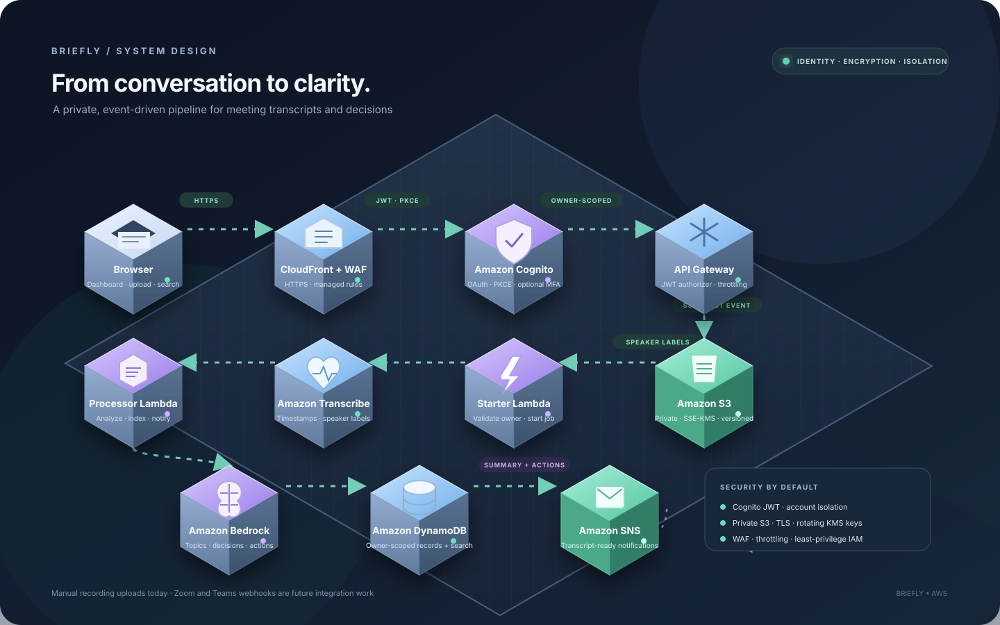

# Briefly — AI Meeting Analyst

Briefly turns meeting recordings into searchable transcripts and useful follow-ups. Upload an audio or video recording, let Amazon Transcribe identify the words and speakers, and let Amazon Bedrock extract the discussion summary, decisions, and action items. Meeting details and a chunked full-transcript search index are stored in DynamoDB. Subscribe an email address to receive a notification when a meeting is ready.

The dashboard works immediately with sample meetings. Connect an AWS deployment to upload and process real recordings.

> **Current deployment:** the original bearer-token walkthrough and configuration below are retained as project history. The deployed infrastructure now uses Amazon Cognito OAuth sign-in with PKCE; follow [Current security and deployment notes](#current-security-and-deployment-notes) for the active setup.

## How the project works

People in every business often have meetings, take notes by hand, and try to remember what was actually decided. Briefly automates that process: meeting recordings are uploaded to Amazon S3 and processed one at a time. An S3 event invokes AWS Lambda, which starts Amazon Transcribe. Transcribe produces a timestamped transcript with speaker labels. When transcription finishes, another Lambda sends the transcript to Amazon Bedrock to extract the important points: key decisions, action items, and the main topics discussed. Meeting summaries and metadata are saved in DynamoDB; the complete transcript and its searchable chunks are stored in S3 and DynamoDB. Amazon SNS can notify subscribers when a transcript is ready.

Type a phrase such as “budget approval” in the dashboard to find matching meeting summaries **and the complete transcript text**, then review who made a decision and what deadline was agreed. Recordings are uploaded to S3 manually for now. Automatically saving recordings from Zoom or Microsoft Teams is a future integration: it will require the platform’s recording APIs and webhooks.

## Architecture



The 3D isometric system map above is part of this README and renders on GitHub. It shows the full recording-to-summary flow and the security controls around each stage.

```text
Browser dashboard (CloudFront + WAF)
  ├── Cognito OAuth / PKCE ──> API Gateway JWT authorizer ──> API Lambda
  └── short-lived presigned POST ──> private, owner-scoped S3 upload
                                             │ S3 ObjectCreated
                                             ▼
                                        Starter Lambda
                                             │
                            Amazon Transcribe (timestamps + speakers)
                                             │ EventBridge completion
                                             ▼
                                        Processor Lambda
                                        ├── Bedrock (summary, decisions, actions)
                                        ├── S3 (full timestamped transcript)
                                        ├── DynamoDB (owner-scoped meetings + search chunks)
                                        └── SNS (ready notification)
```

Terraform also provisions a private static-assets bucket behind CloudFront, the API, least-privilege Lambda roles, encryption, CORS, and optional email notifications. EventBridge routes completed or failed Transcribe jobs to the processor; SNS sends the ready notification. The older bearer-token setup instructions later in this README describe the initial implementation and are retained for history; they are not used by the current Cognito-based deployment.

## Deploy

### Prerequisites

- An AWS account and AWS CLI credentials with permission to create the resources described below.
- Terraform 1.5 or later.
- An AWS region where Amazon Transcribe and the selected Bedrock model are available. Enable access to the model in the Bedrock console before processing a real recording.

### 1. Configure Terraform

In a terminal opened in this project:

```powershell
Set-Location "D:\The market analyst\infra"
Copy-Item terraform.tfvars.example terraform.tfvars
```

Edit `terraform.tfvars` and set your AWS region and a long, random `api_token` (at least 32 characters). Optionally set `notification_email` to receive SNS notifications; AWS sends a subscription confirmation to that address, which must be confirmed before notifications arrive.

Keep `terraform.tfvars` and the Terraform state private. Do not commit either file or share the bearer token. For a team or production deployment, use a managed identity provider, such as Amazon Cognito, instead of a shared token.

### 2. Provision the application

```powershell
terraform init
terraform validate
terraform apply
```

Review the plan and confirm the apply. The deployment creates billable AWS resources, including CloudFront, S3, DynamoDB, Lambda, Transcribe, Bedrock access, and SNS. Usage-based charges apply; remove the deployment when it is no longer needed.

### 3. Open the dashboard

```powershell
terraform output -raw dashboard_url
terraform output -raw api_url
terraform output -raw api_token
```

Open `dashboard_url` in a browser, choose **Connect workspace**, and enter the API URL and token. The API URL and token are also shown as Terraform outputs; the token output is sensitive, so use it only in a trusted terminal.

### 4. Process and search a recording

Choose **Upload recording**, select a supported audio/video file (MP3, MP4, WAV, FLAC, OGG, WebM, AMR, or M4A), and upload it. Keep the browser tab open until the S3 upload completes. Transcription and analysis then run asynchronously. Refresh the meetings view to see processing progress; completed meetings include the summary, decisions, action items, speaker-labelled transcript, and audio playback link.

Use the search box to find words in the summary or anywhere in the full transcript. The transcript search index uses DynamoDB chunks, so long transcripts do not have to fit in a single DynamoDB item. A DynamoDB scan is suitable for a small project/demo; for large collections or high query volume, use a dedicated search service such as Amazon OpenSearch Service.

## Configuration

| Terraform variable | Default | Purpose |
| --- | --- | --- |
| `aws_region` | `us-east-1` | AWS deployment region |
| `project_name` | `briefly-meeting-analyst` | Prefix for provisioned resource names |
| `api_token` | required | Shared bearer token required by the API; set a private value in `terraform.tfvars` |
| `notification_email` | empty | Optional SNS email subscriber |
| `bedrock_model_id` | `anthropic.claude-3-haiku-20240307-v1:0` | Bedrock model used to analyze transcripts |
| `transcribe_language_code` | `en-US` | Transcription language |

The initial implementation assumes English transcription and diarizes up to ten speakers. Recordings are uploaded manually; Zoom and Microsoft Teams integrations are not included.

## Local dashboard

Open `web/index.html` directly in a browser to explore the sample dashboard. It runs without AWS credentials and clearly labels the sample data. Uploading or searching real meetings requires a deployed API and workspace token.

## Tear down

From `infra`, run:

```powershell
terraform destroy
```

Review the plan before confirming. The recordings bucket has deletion protection through `force_destroy = false`; empty all object versions (for example, use **Empty** in the S3 console) if you want to remove it, or preserve the bucket before tearing down the infrastructure.

## Project structure

```text
backend/   Python Lambda handlers for the API and asynchronous pipeline
infra/     Terraform configuration, variables, and deployment outputs
web/       Responsive dashboard (plain HTML, CSS, and JavaScript)
docs/      README-embedded 3D isometric architecture illustration
```

## Project 4: AI Meeting Analyst

Every business worker has meetings, writes notes manually, and tries to remember what was actually decided. There is no automatic note-taking system right now that records meetings and makes AI summaries, so this project builds one that converts meeting recordings into searchable transcripts and intelligent summaries.

The first version starts simply: a recording is downloaded from a meeting platform and manually uploaded to Amazon S3. S3 events allow the files to be processed one by one by AWS Lambda. Once triggered, Lambda sends the audio to Amazon Transcribe, which can handle multiple speakers and background noise and produces a full transcript with timestamps and speaker labels. Lambda then sends the transcript to Amazon Bedrock, which extracts the important information: key decisions, action steps, and the main topics discussed. Meeting data is stored in DynamoDB, and Amazon SNS can send a notification when a transcript is ready.

The search function queries DynamoDB: enter a phrase such as “budget approval” to find matching meetings, then review who made the decision and what deadline the team agreed on. Results are available immediately in the dashboard. Recordings are still uploaded manually to S3; automatically integrating Zoom or Microsoft Teams APIs and webhooks to save recordings as soon as meetings end is a future challenge and is not included in this version.

### Project brief (as provided)

Business workers often have meetings manually, write notes, and try to remember what was actually decided. There is no automatic note-taking system right now that records and makes AI summaries, but we're going to build our own and make it way better.

We are building a system that can automatically convert meeting recordings into searchable transcripts and intelligent summaries.

For this project, we're going to start very simple. You're going to download a recording from a platform that you like and take meetings, and then upload it to S3.

From there, we'll use S3 to form the files and process them one by one. As soon as they're ready, we're going to set up Lambda.

Once triggered, it sends the audio to Amazon Transcribe. AWS's speech-to-text service is smart enough to handle multiple speakers and filter out any background noise, giving us a full transcript with timestamps. And here is where it gets interesting: we then send that transcript to Amazon Bedrock, and it asks it to extract the important stuff, like the key decisions, the action steps, and the main topics discussed.

Everything then gets stored in DynamoDB, and then we can use SNS to send notifications when transcripts are ready.

We then need to build a simple search function that queries DynamoDB. Type in budget approval and it searches through all your stored transcripts and summaries to find matching meetings.

And the best part is that it's immediate, and we can easily search back and see who made the important decision on what deadline that you guys have agreed on.

Right now, we're still manually uploading meeting recordings to S3.

So, one of the next challenges will be figuring out how to automatically upload and integrate this project with Zoom or Microsoft Teams.

So, we can add it to the API integration and platform webhooks to auto-save recordings directly to S3 the moment the meeting ends.

## Current security and deployment notes

This section documents the current Cognito-based deployment and supersedes the earlier bearer-token setup examples above. The existing project description and walkthrough are retained for context; **there is no `api_token` Terraform variable in the current configuration**.

### Security layers

- **Identity and session:** Amazon Cognito provides verified-email sign-in through OAuth authorization code with PKCE. The public browser client has no client secret. Access and refresh tokens are kept in the current tab's `sessionStorage`; access tokens are short-lived. Strong password rules are configured, and authenticator-app MFA is available as an optional user setting.
- **API authorization:** API Gateway validates the Cognito JWT before invoking Lambda and applies request throttling. The API derives the user ID from the verified JWT `sub` claim; it does not accept an owner ID supplied by the browser.
- **Account isolation:** Upload keys include the authenticated owner ID. Meeting details, summaries, and transcript search results are checked or filtered against the same owner ID before they are returned.
- **Edge and transport:** CloudFront redirects viewers to HTTPS and adds security headers. AWS WAF managed common protections and an IP-based rate limit protect the dashboard edge. S3 bucket policies deny insecure transport.
- **Storage and permissions:** Recording and dashboard S3 buckets are private, block public access, and use rotating KMS keys; the recordings bucket is versioned. DynamoDB enables encryption at rest and point-in-time recovery for meeting records. Lambda roles are scoped to the resources and actions each function needs, with bounded concurrency.
- **Upload and abuse limits:** Upload links are presigned, short-lived, limited to supported audio/video extensions, and capped at 500 MB. API Gateway and WAF throttles add request-level protection.

These controls provide defense in depth, not a guarantee that a deployment is suitable for every regulated workload. Review AWS account permissions, data-retention requirements, Cognito MFA policy, model access, and the applicable privacy obligations before processing sensitive recordings.

### Deploy the current configuration

Prerequisites are Terraform 1.5+, AWS CLI credentials authorized to create the resources in `infra/main.tf`, and an AWS region with Amazon Transcribe and the selected Amazon Bedrock model available. Enable model access in Bedrock before processing recordings.

1. From the project root, configure the example variables:

   ```powershell
   Set-Location "D:\The market analyst\infra"
   Copy-Item terraform.tfvars.example terraform.tfvars
   ```

   Set `aws_region`, `project_name`, and, optionally, `notification_email`, `bedrock_model_id`, and `transcribe_language_code` in `terraform.tfvars`. There is no shared API token to generate. Keep Terraform state and `terraform.tfvars` private.

2. Initialize and inspect the proposed infrastructure:

   ```powershell
   terraform init
   terraform validate
   terraform plan
   ```

3. Apply the reviewed plan:

   ```powershell
   terraform apply
   ```

   This provisions billable AWS resources. CloudFront can take several minutes to become available. Terraform outputs include `dashboard_url`, `api_url`, the Cognito user-pool/client details, and the storage resource names.

4. Open the `dashboard_url`, choose **Sign in securely**, register with a verified email, and complete the email verification step. The user pool supports optional authenticator-app MFA; administrators should configure enrollment or enforcement using the Cognito controls appropriate for their deployment. The dashboard does not include a separate MFA enrollment screen. New users register through the Cognito-hosted sign-in page.

5. Upload a supported recording from the dashboard. Processing is asynchronous; refresh the meeting list after a few minutes to see the transcript, decisions, summary, action items, and ready status. Optional email alerts require confirming the SNS subscription email.

Protect the Terraform state: it records infrastructure details and may contain generated configuration. Do not publish it or commit `terraform.tfvars`. To tear down, run `terraform destroy` from `infra`; because the recordings bucket is versioned and protected from force deletion, intentionally empty all object versions before removing it.

### Architecture diagram

The 3D architecture diagram is embedded in this README as [`docs/architecture.svg`](docs/architecture.svg). It is documentation rather than a dashboard page; the deployment serves the dashboard UI only.
